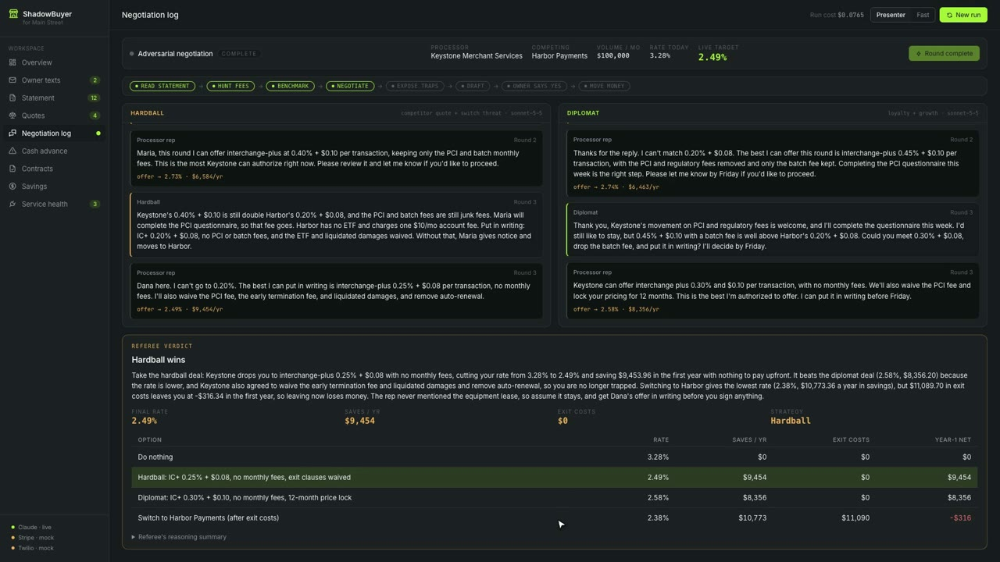

# ShadowBuyer for Main Street

**A swarm of AI agents that gets independent restaurant owners their card-processing money back, over text.**

The owner texts a photo of their card-processing statement. The swarm finds the hidden fees, translates the "simple factor" cash advance in their inbox into a real APR, and negotiates a lower rate with the processor. After the owner replies **YES**, it executes the fix in a sandbox and hands them a lender-ready PDF.

> Demo outcome (computed, not invented): **3.28% → 2.49% = $9,454/yr back**, plus a "1.35 factor" merchant cash advance exposed at **~93% APR** before the owner signed.

## Watch the demo

[](https://github.com/LeSingh1/Deca-Hackathon-IHS/releases/download/v1.0.0/shadowbuyer-demo.mp4)

**[▶ Download the demo video](https://github.com/LeSingh1/Deca-Hackathon-IHS/releases/download/v1.0.0/shadowbuyer-demo.mp4)** (about 3 minutes, 24 MB, narrated and captioned). It's recorded from the running app in zero-key mock mode: the full run, a question at the approval gate, YES, the PDF, then a second run that uses memory and ends in NO.

## The problem

- **Who:** an independent, single-location full-service restaurant doing about **$1.2M a year in card sales** on **3–4% margins**.
- **What it costs:** card processing takes roughly **2–3% of every swipe**, about as much as the restaurant keeps in profit. Much of it hides in tier surcharges, junk fees ("regulatory", PCI non-compliance, statement and batch fees) and merchant agreements with liquidated-damages clauses and non-cancellable terminal leases.
- **The trap next door:** merchant cash advances are sold as a "factor rate" (1.35 sounds like 35%) but are repaid by daily debits over months, so the true cost is commonly **60–150% APR**.
- These ranges are general industry figures, given for context. The demo's numbers come from its fictional, labeled fixtures.

**This is not an expense tracker, receipt chatbot or invoice generator.** It doesn't categorize spending or add a dashboard for the owner. It takes actions that put money back in the owner's account, and the owner's whole interface is one text thread.

## How it works

```
Owner texts statement photo (Twilio SMS or the phone simulator, same webhook handler)
  → Statement Reader     Sonnet 5.5 vision → line items (must sum to the printed total)
  → Fee Hunter           Haiku 5.5 → interchange / assessments / markup / junk / lease
  → Rate Scout           deterministic: fair IC+ benchmark + competitor quotes + exit costs
  → Negotiator swarm     Hardball & Diplomat (Sonnet 5.5) vs. Processor Rep (Haiku 5.5), 3 rounds, streamed
  → Referee              Opus 5.5 (adaptive thinking): explains the calculator's best first-year-net option
  → Contract Exposer     Opus 5.5 (adaptive thinking): MCA true APR + redlines for both documents
  → Action Drafter       Sonnet 5.5: rep email; templated 3-line owner SMS
  → owner replies YES    approval event (nothing leaves the building before this; unclear replies get re-asked)
  → Executor             dry-run rep email · fee receipt · Stripe test-mode savings sweep
  → Savings ledger + lender-ready PDF + memory for next month's run
```

### Rules the code enforces

1. **Money math is code, never the model.** `src/finance/` holds pure, unit-tested functions: `effective_rate`, `fee_breakdown`, `plan_monthly_cost`, `annual_savings`, `mca_true_apr` (IRR on the daily remittance schedule, APR = daily IRR × 365), `early_termination_cost`, `net_switch_benefit`. The rep's offers come from a fixed concession ladder priced by these functions. Model-written prose (Referee rationale, redlines, rep email) passes a **number guard**: any $ or % that isn't a calculator output sends the agent back to its template.
2. **Mock fallback everywhere.** With zero env vars, the full demo runs on deterministic fixtures. Any live failure (network, auth, refusal, schema mismatch after one retry) degrades to the fixture. Header chips show `live`/`mock` per service. The one exception is a real owner's photo: if it can't be read, they're told so and are never shown the fixture's numbers.
3. **Human in the loop.** The pipeline blocks at `approval_requested`. Executor functions raise `ApprovalRequired` without an approved `Approval`. Every action is sandbox and labeled as such. Replies are read conservatively: "yes please" approves, "no thanks" declines, and anything unclear ("what does this mean?", "yes but not the email") gets re-asked with the gate still closed. Once made, a decision can't be flipped by a later text.
4. **Honest data.** Benchmark and competitor figures carry `source`, `as_of` and `illustrative`. The merchant, processor, lender and documents are fictional.
5. **Frozen contract.** `src/contract.py` (v1.0.0) is mirrored in `frontend/src/lib/contract.ts`. Every event is validated at emit time, and a test fails if the two files drift.
6. **Approvals can't be forged.** With Twilio live, `POST /sms/twilio` rejects any request without a valid `X-Twilio-Signature`. The public simulator can only start the demo fixture and can only answer simulator runs, so it can't reach a real owner's approval. On a shared demo, each browser's reply goes to the run it's watching.

## What's real vs. sandbox

| Piece | Status |
|---|---|
| All dollar figures, rates, APRs | Real calculations (unit-tested) on fictional fixture data |
| Claude agents | Live with `ANTHROPIC_API_KEY`; deterministic fixtures without it |
| Statement vision parse | Live on the fixture PDF or an MMS photo; validated against the printed total |
| Negotiation | The processor rep is **simulated** (Haiku 5.5 bound to a concession ladder). Nobody real is contacted. |
| Rep email | **Dry run**: drafted and shown, never sent |
| Savings sweep | With a `sk_test_` key: **Stripe test mode** PaymentIntent with metadata `bucket=Tax & Rainy-Day reserve`. Without one, a labeled mock. `sk_live_` keys are refused. No real money moves either way. Production rail would be FedNow. |
| SMS | Twilio sandbox/trial number if configured; otherwise the in-app phone simulator (same handler) |
| Memory | Local JSON file: owner profile, past statements, decisions, winning tactics. On the next run the winning negotiator opens from what worked; the offers still come from the ladder. |
| A real owner's statement | The fee analysis uses the parsed statement, but the merchant agreement, cash-advance offer, MID, owner name and processor rep are still the fictional fixtures. This shows the flow end to end; it isn't ready for real owners to rely on. |

## Models (`src/llm/models.py`, the only place they're set)

| Agent | Model | Why |
|---|---|---|
| Statement Reader | `claude-sonnet-5-5` | vision + structured output, fast |
| Fee Hunter | `claude-haiku-5-5` | high-volume classification, cheap |
| Hardball / Diplomat | `claude-sonnet-5-5` | fast streaming turns |
| Processor Rep | `claude-haiku-5-5` | pushes back realistically, bound to the ladder |
| Referee | `claude-opus-5-5` | hardest judgement call; adaptive thinking, summary shown |
| Contract Exposer | `claude-opus-5-5` | long-document legal-ish reasoning; adaptive thinking |
| Action Drafter | `claude-sonnet-5-5` | tone + brevity |

`SHADOWBUYER_USE_FABLE=1` moves the Referee and Contract Exposer to `claude-fable-5-1`. `SHADOWBUYER_MODEL_<AGENT>=<id>` overrides any single agent. To route one agent to a different provider, register it with `register_provider()` and set that agent's `provider` field. Agent code doesn't change.

API features used (Anthropic Python SDK): `messages.parse` structured outputs with Pydantic schemas (one retry, then the fixture), `messages.stream` for negotiator turns, `cache_control` on the shared context (fee taxonomy, benchmarks, documents), adaptive thinking with `display: "summarized"` on Opus agents (only the summary reaches the UI), `output_config.effort` per agent, and per-agent token/cost logging (`cost_log` events and the header readout).

## Run it

```bash
# one command: creates .venv, builds the UI, serves UI + API on http://localhost:8000
# needs Python 3.12+ and Node 22+; loads .env if you made one (cp .env.example .env)
./scripts/dev.sh

# or Docker (also what Zeabur builds via zeabur.toml)
docker build -t shadowbuyer . && docker run -p 8000:8000 --env-file .env shadowbuyer

# UI dev server with hot reload (proxies /api to :8000)
cd frontend && npm run dev
```

Then click **Run demo**, or text a statement photo (or the word DEMO for the sample run) to your Twilio number. Choose **Presenter (~75 s)** or **Fast (~10 s)** in the header.

### Environment variables (all optional; see `.env.example`)

| Variable | Flips |
|---|---|
| `ANTHROPIC_API_KEY` | every agent to live Claude |
| `STRIPE_SECRET_KEY` (`sk_test_…` only) | savings sweep to a real Stripe test-mode PaymentIntent |
| `TWILIO_ACCOUNT_SID`, `TWILIO_AUTH_TOKEN`, `TWILIO_FROM_NUMBER` | SMS channel (webhook: `POST /sms/twilio`) |
| `SHADOWBUYER_PUBLIC_URL` | your public base URL when behind a proxy; Twilio signatures are checked against it |
| `SHADOWBUYER_LLM=mock` | force mock even with a key |
| `SHADOWBUYER_APPROVAL_TIMEOUT_S` | how long a run waits for YES (default 900) |
| `SHADOWBUYER_MEMORY_PATH` | where the memory JSON lives (default `.shadowbuyer-memory.json`) |

### API

| Endpoint | Purpose |
|---|---|
| `POST /api/demo/start?pace=presenter\|fast` | the owner texts the fixture statement |
| `POST /api/sms/inbound` `{from, body, media[], run_id?}` | phone simulator (same handler as Twilio); `media` accepts only the demo fixture, `run_id` picks the run to answer |
| `POST /sms/twilio` | Twilio webhook (form-encoded, signature checked when live) |
| `GET /api/runs/{id}/events` | SSE stream (replay + tail, resumes on `Last-Event-ID`) |
| `GET /api/runs/{id}/report.pdf` | lender/accountant-ready PDF |
| `GET /api/services`, `/healthz` | live/mock per service |

## Tests

```bash
python3 -m venv .venv && .venv/bin/python -m pip install -r requirements-dev.txt
.venv/bin/python -m pytest -q    # 85 tests, ~3 s
cd frontend && npm ci && npm run typecheck
```

- `tests/test_finance.py`: every calculator, including the hand-checked APR example (`=RATE(120,100,-10000)*365 = 113.668%`, cross-checked against an independent closed-form solve).
- `tests/test_contract.py`: the Python and TypeScript contracts agree.
- `tests/test_pipeline.py`: a zero-env end-to-end run whose headline numbers are recomputed independently from the fixtures; no action before approval and none after NO; Stripe refuses live keys; memory makes the second run smarter; live mode calls exactly the models in `models.py` (and still yields the calculator numbers when the model returns nothing); the simulator → SSE → YES → PDF API flow.
- `tests/test_llm_sdk.py`: the real Anthropic SDK against a mocked HTTP transport.
- `tests/test_hardening.py`: path traversal, natural yes/no/unclear replies, forged and misrouted approvals, Twilio signatures, malformed input, real uploads never showing fixture numbers, sandbox labels, memory.

## Repo layout

```
src/
  finance/      deterministic money math (rates, mca, contracts)
  agents/       statement_reader, fee_hunter, rate_scout, negotiator, referee, contract_exposer, action_drafter
  llm/          models.py (agent → model), client.py (providers, structured, streaming, caching, cost), guard.py
  executor/     approval-gated actions (Stripe test mode, dry-run email, fee receipt)
  channels/     Twilio SMS
  memory/       local JSON memory (next month's run starts from what worked)
  report/       PDF
  contract.py   frozen SSE event contract
  pipeline.py   the swarm, as a generator of contract events
  runs.py       run manager: pacing, validation, approval gate, SSE fan-out
  app.py        FastAPI
frontend/       Vite + React 19 + Motion, two-screen UI
fixtures/       fictional statement (JSON + PDF), taxonomy, benchmarks, quotes, MCA offer, agreement, redlines, ladder
tests/          calculators, contract drift, pipeline, SDK-level LLM, hardening
scripts/        dev.sh (one command), make_statement_pdf.py
demo/           the demo video and its poster frame
legacy/         the pre-hackathon procurement ShadowBuyer, unchanged (see PRIOR_WORK.md)
```

See [DEMO.md](DEMO.md) for the 3-minute script and [PRIOR_WORK.md](PRIOR_WORK.md) for the prior-work disclosure.

## Status

**Verified:** the full demo runs in a real browser with zero keys (both YES and NO paths), and the 85 tests, typecheck and production build all pass.

**Not yet exercised against the real services:** live Claude calls (tested through the real SDK with a mocked HTTP transport), Stripe test mode, Twilio delivery, and the Docker image itself (its build steps were run by hand, without Docker). Run these with real keys before relying on them.

*Informational only; not legal or financial advice.*
